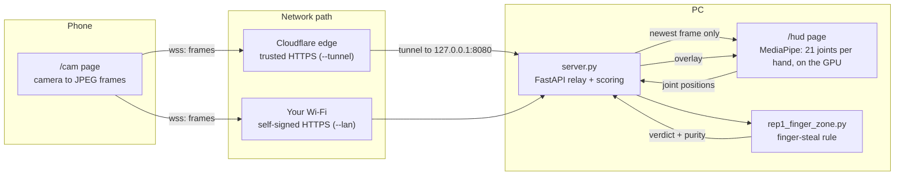

# KeySight

Your phone watches your hands type. Your PC draws a dark Iron-Man skeleton of both hands (all 42 joints) and tells you when a finger steals a key that belongs to another finger.

Hand tracking runs in your PC's browser on the GPU (MediaPipe). The phone only sends camera frames; the Python server relays them and scores your typing.

## Start it (about 2 minutes the first time)

**Windows**: double-click `Start-KeySight.cmd`, or in PowerShell:

```powershell
.\Start-KeySight.ps1            # asks how the phone should connect
.\Start-KeySight.ps1 -Tunnel    # trusted HTTPS address, no certificate warning
.\Start-KeySight.ps1 -Lan       # your Wi-Fi only, one certificate warning
```

The `.cmd` wrapper runs the script with `-ExecutionPolicy Bypass`, so Windows never blocks it. Everything you pass to the `.cmd` goes through (`Start-KeySight.cmd -Tunnel`).

**Any system with Python 3.10+:**

```bash
python -m venv .venv
.venv/bin/pip install -r requirements.txt     # Windows: .venv\Scripts\pip
python fetch_assets.py                        # hand-tracking files, once (about 30 MB)
python server.py --tunnel                     # or --lan
```

The first run builds the Python environment and downloads the hand-tracking files. After that, tracking works offline.

## Two ways to connect the phone

A phone camera only works on a secure (HTTPS) page, so the phone needs an HTTPS address.

| | `--tunnel` | `--lan` (default) |
|---|---|---|
| Phone address | `https://<name>.trycloudflare.com/cam` | `https://<your PC's Wi-Fi address>:8443/cam` |
| Certificate | Real, trusted. Green padlock, no warning. | Self-signed. One warning: **Advanced**, then **Continue**. |
| Needs | Internet on the PC and phone | Phone and PC on the same Wi-Fi |
| Path of the frames | Phone, Cloudflare, your PC | Phone straight to your PC |
| PC HUD | `http://localhost:8080/hud` | `https://localhost:8443/hud` |

**Tunnel mode** downloads the official `cloudflared` once into `vendor/` (git-ignored), unless it is already installed. It starts KeySight on `127.0.0.1:8080`, opens a Cloudflare quick tunnel, reads the new `trycloudflare.com` address and prints a QR code for `/cam`. Press **Ctrl+C** to close the address. The address is random and changes every run. Treat it as private while it is open.

In tunnel mode the HUD page and `/ws/hud` refuse requests that arrive through Cloudflare, so nobody who sees the address can watch your camera feed. The HUD opens only on the PC that runs KeySight.

**LAN mode** makes its own certificate for your PC's Wi-Fi addresses and keeps all traffic on your network. If Windows asks about Python and the firewall, allow **Private networks**.

**No phone handy?** In the HUD click **Use PC webcam**. That works in both modes.

Point the camera at your keyboard hands. Both hands appear with glowing bones, finger badges (Thumb / Index / Middle / Ring / Pinky), live FPS, and **10-Finger Purity %**.

## How the pieces fit



The pages pick `ws:` or `wss:` from the address they were opened on (`location.protocol === 'https:' ? 'wss:' : 'ws:'`), so the same pages work on the tunnel, on the LAN certificate and on `http://localhost`.

| File | Job |
|---|---|
| `Start-KeySight.cmd` | Windows wrapper, never hits an execution-policy error |
| `Start-KeySight.ps1` | One command: environment, downloads, mode choice, server |
| `server.py` | HTTPS certificate, tunnel, QR code, frame relay, scoring |
| `rep1_finger_zone.py` | Rep #1 logic (the file you edit) |
| `test_rep1.py`, `test_server.py`, `test_tunnel.py` | Tests |
| `static/cam.html` | Phone page |
| `static/hud.html` | PC HUD |
| `fetch_assets.py` | Downloads MediaPipe files into `static/vendor` (git-ignored) |

## What Rep #1 checks

Ring and Pinky own the outer keys. If your **Index** or **Middle** fingertip slides sideways into the Ring or Pinky column, that finger is a thief. The HUD turns it red, flashes **FINGER-STEAL ALERT**, and your purity score drops. Staying home slowly earns it back.

The logic is one function in `rep1_finger_zone.py`:

```python
classify_finger_steal(hand_label, landmarks)
# -> {"steal": bool, "thief_finger": str, "zone": str, "purity_delta": float}
```

## Your first 10-minute tweak

Goal: make the alert **stricter**, then prove it with a test.

**Minutes 0-2: see it work.** Start KeySight. Type on your keyboard and watch the badges. Slide your Index finger toward your Pinky and watch it turn red.

**Minutes 2-5: change one number.** Open `rep1_finger_zone.py` in any editor. Find this line:

```python
half_gap = abs(width) / 6
```

A zone starts half a finger-gap before the Ring or Pinky fingertip. Change `/ 6` to `/ 4`. The zone now starts earlier, so smaller drifts count. Change it to `/ 12` for a looser rule. (Do not go below `/ 3`: then even a relaxed hand counts as stealing.)

**Minutes 5-7: break the test on purpose.**

```bash
pip install -r requirements-dev.txt
python -m pytest -q
```

`test_middle_halfway_to_ring_is_not_yet_a_steal` fails. That is correct: the test described the old rule.

**Minutes 7-10: fix the test.** Open `test_rep1.py` and update that test to the new boundary (with `/ 4` the Ring zone starts at `0.50 - 0.0375 = 0.4625`, so a Middle fingertip at `0.47` is now a steal: flip that assert, and rename the test). Run pytest until it is all green, then restart KeySight and feel the difference.

**Bonus tweaks:**
- The three numbers at the top of the file (`CLEAN_REWARD`, `RING_PENALTY`, `PINKY_PENALTY`) set how fast purity moves per video frame.
- If LEFT and RIGHT labels look backwards, click **Swap L/R labels** in the HUD.

## Tests

```bash
pip install -r requirements-dev.txt
python -m pytest -q
```

The suite covers Rep #1, the relay over `http`/`ws` and `https`/`wss` (including a real self-signed server on real sockets), the tunnel address parser, `cloudflared` lookup and download, and the tunnel-mode HUD guard.

## Notes

- The LAN certificate lives in `certs/` (git-ignored) and is remade if your PC's Wi-Fi address changes.
- `cloudflared` is downloaded from the official Cloudflare releases page. Install it yourself first if you prefer; KeySight uses an installed copy before downloading.
- Frame rate is limited by the phone camera (usually 30-60 FPS). The HUD shows both the phone rate (`CAM`) and the tracking rate (`FPS`).
- Landmarks use MediaPipe Tasks Vision `1.2.3`, pinned in `fetch_assets.py`.

## License

MIT. See `LICENSE`.
